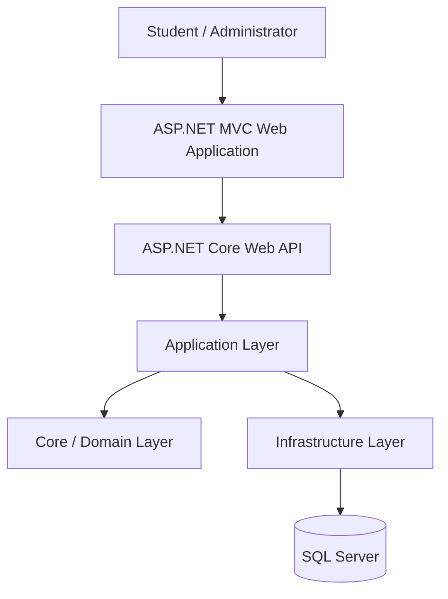

<div align="center">

# Varsity Trade

### A Student Marketplace for South African Universities

A full-stack marketplace built to help university students buy, sell, and trade within their campus community.

[](https://dotnet.microsoft.com/)
[](https://learn.microsoft.com/en-us/dotnet/csharp/)
[](https://learn.microsoft.com/en-us/aspnet/core/)
[](https://www.microsoft.com/en-us/sql-server)
[]()

</div>

---

## About the Project

Varsity Trade is a full-stack student marketplace web application designed for South African university students.

The idea is simple: make buying, selling, and trading within a university community easier and safer by connecting marketplace activity to a student's registered university.

The platform is being developed as a real-world software project, with a focus on backend engineering, database design, authentication, API development, and maintainable application architecture.

## The Problem

Students often need affordable items such as textbooks, electronics, furniture, and other university essentials. Finding trustworthy buyers and sellers within the same campus community can be difficult.

Varsity Trade aims to provide a dedicated marketplace where students can connect, negotiate, and exchange items within a university-based environment.

## Key Features

- University-based marketplace
- Buyer and seller functionality
- Seller profiles
- Product listings and categories
- Buyer-seller messaging
- Cash and trade offers
- Transaction management
- Reviews linked to completed transactions
- Notifications
- Admin moderation and platform management
- Hero banner management
- JWT authentication with refresh-token support

## Project Screenshots

<!-- Add screenshots or a short demo GIF here once captured.
     Suggested location: docs/images/
     
     Example:
     
-->

*Application screenshots and a feature walkthrough will be added as development progresses.*

## Technology Stack

| Technology | Purpose |
|---|---|
| C# / .NET | Primary development platform |
| ASP.NET Core Web API | REST API and backend services |
| ASP.NET MVC / Razor | Web application frontend |
| Entity Framework Core | ORM and database access |
| SQL Server | Relational database |
| JWT + Refresh Tokens | Authentication |
| Swagger / OpenAPI | API documentation and testing |
| Postman | API testing |
| Git / GitHub | Version control and collaboration |
| .NET MAUI | Planned mobile application |

## Architecture

The solution follows a layered structure to separate application responsibilities and improve maintainability.

```text
VarsityTrade
│
├── VarsityTrade.API
│   └── Controllers, HTTP endpoints and startup
│
├── VarsityTrade.Application
│   └── Application services and business operations
│
├── VarsityTrade.Core
│   └── Core models, DTOs and domain definitions
│
├── VarsityTrade.Infrastructure
│   └── Database and infrastructure concerns
│
└── VarsityTrade
    └── ASP.NET MVC / Razor web application
```

### Architecture Overview



## Engineering Focus

This project gives me practical experience with:

- Designing and maintaining a layered application architecture
- Building RESTful APIs with ASP.NET Core
- Modelling relational data and entity relationships
- Implementing authentication and protected resources
- Managing database access with Entity Framework Core
- Separating business logic from infrastructure concerns
- Debugging API, database, and frontend integration issues
- Working with Git branches and feature-based development

## Local Setup

### Requirements

- .NET 10 SDK
- SQL Server (LocalDB or SQL Server Express)
- Visual Studio or another .NET IDE

### 1. Clone the repository

```bash
git clone https://github.com/thabocoolT/VarsityTrade.git
cd VarsityTrade
```

### 2. Configure development secrets

The API reads its database connection string and JWT signing key from .NET configuration.

From the repository root, configure User Secrets for the API project:

```powershell
dotnet user-secrets --project VarsityTrade.API set "ConnectionStrings:DefaultConnection" "Server=localhost\SQLEXPRESS;Database=VarsityTradeDB;Trusted_Connection=True;TrustServerCertificate=True;"

dotnet user-secrets --project VarsityTrade.API set "JwtSettings:SecretKey" "<your-new-random-secret-at-least-32-characters-long>"
```

Use your own SQL Server instance and database settings. Never commit real credentials or signing keys.

### 3. Restore and run

```bash
dotnet restore VarsityTrade.slnx
```

Then:

1. Apply the database migrations using your configured SQL Server connection.
2. Start the `VarsityTrade.API` project.
3. Start the `VarsityTrade` MVC web project.
4. Ensure `ApiSettings:BaseUrl` points to the API's local HTTPS address.

## Project Status

🚧 **Active Development**

Varsity Trade is being developed incrementally. The architecture and features may evolve as the application grows.

The current focus is on building a reliable web marketplace, with a mobile application planned as a future phase.

## Future Direction

- Complete and refine the marketplace experience
- Improve validation, security, and error handling
- Add more comprehensive automated testing
- Capture application screenshots and create a feature demo
- Develop the planned mobile application using .NET MAUI

## About the Developer

Built as a personal software-development project to apply and strengthen practical skills in backend development, database design, API engineering, and software architecture.

---

**Repository:** [thabocoolT/VarsityTrade](https://github.com/thabocoolT/VarsityTrade)
